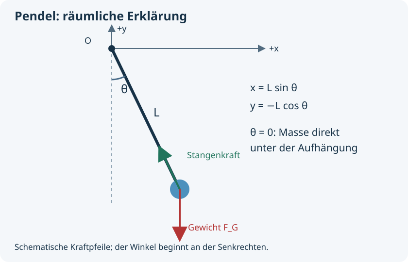
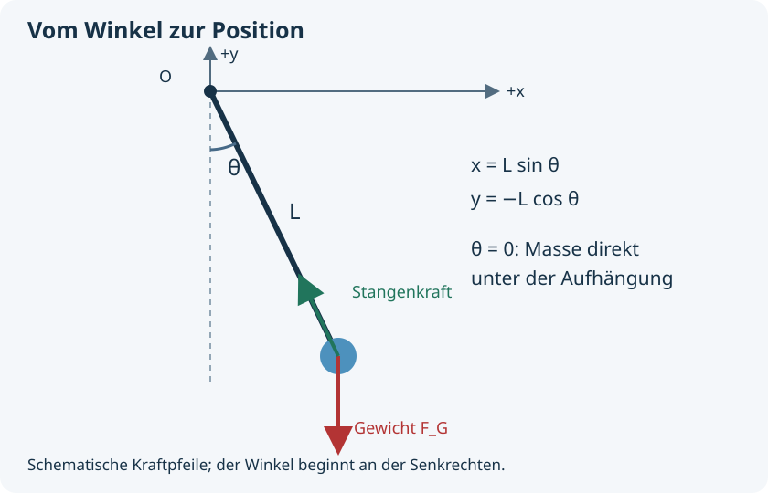

# Räumliche Modelle verstehen

Ein Pendel bewegt sich in einer Ebene, kann aber aus einer räumlichen Kamera
beobachtet werden. Der Kamerablick und der physikalische Zustand sind zwei
verschiedene Dinge. Die eingebettete 3D-Erklärung in Physims Dokumentationsfenster
zeigt diese Unterscheidung mit drehbarer Ansicht, Reglern und zugehörigen Zahlen.

## Direkt in der App ausprobieren

Drücke F1 und öffne unter **Lernen & Bedienung** das Thema **Räumliche Modelle
verstehen**. Die Regler und Szene erscheinen direkt in der Hilfe. Es gibt keinen
Browser, Server oder HTML-Inhalt. Der native 3D-Renderer stellt das Modell dar;
alle Lernschritte funktionieren offline. SecondBrain erhält dieselben Zusammenhänge
als Text und Zahlen.

Quellenlinks kopieren ihre Adresse. Du bleibst dabei in Physim; die vollständigen
Lerntexte und Beispiele liegen im eingebauten Handbuch.

Mit Tab erreichst du die Regler, die Kameratasten, die Projektion und die Szene.
Pfeiltasten ändern den fokussierten Regler. In der fokussierten Szene drehen sie
die Kamera; Bild auf/ab zoomt und Pos1 stellt die Raumansicht wieder her.
Mit der rechten Maustaste kannst du die Szene ebenfalls drehen.

## Winkel und Koordinaten verbinden

Eine Punktmasse hängt an einer masselosen Stange mit Länge L. Der
Aufhängepunkt ist der Ursprung. Der Winkel θ wird von der nach unten zeigenden
Senkrechten gemessen. Daraus folgen `x = L sin θ`, `y = −L cos θ`, `z = 0`.
Für θ = 0 liegt die Masse also bei `(0, −L, 0)`.

Die räumliche Kamera kann die gleiche Ebene schräg zeigen. Ändert sich dabei
nur die Kamera, bleiben x, y, z, Winkel, Kräfte und Energie unverändert.
Eine orthografische Kamera verzichtet auf die perspektivische Größenänderung
mit der Tiefe. In der Physim-App wählst du Kamera und Projektion unter
[Darstellung und Kamera](workspace.md#szene-untersuchen).

## Kräfte und Geschwindigkeit unterscheiden

Bei m = 1 kg und g = 9,80665 m/s² zeigt die Gewichtskraft nach unten.
Die Stangenkraft zeigt zum Aufhängepunkt und hat den Betrag
`m(g cos θ + Lω²)`. Die Geschwindigkeit ist tangential:
`v = Lω(cos θ, sin θ, 0)`.

In der räumlichen Erklärung verwenden die Kraftpfeile 0,05 m/N und der
Geschwindigkeitspfeil 0,3 s. Ein längerer gelber Pfeil bedeutet deshalb nicht,
dass eine Geschwindigkeit größer als eine Kraft wäre. Vergleiche Größen mit
gleicher Dimension und beachte den jeweiligen Maßstab.

## Drei eigene Beobachtungen

1. Sage die Position für θ = 0 voraus. Stelle sie in der Ansicht ein und prüfe
   die ausgegebenen Koordinaten.
2. Verdopple L bei gleichem θ. Prüfe, wie x und y reagieren. Drehe anschließend
   nur die Kamera und erkläre, weshalb die Zahlen gleich bleiben.
3. Erhöhe ω bei gleichem Winkel. Erkläre den zusätzlichen Anteil `Lω²` in der
   Stangenkraft. Prüfe, weshalb auch die kinetische Energie zunimmt.

Die Ansicht stellt von dir gewählte momentane Zustände dar. Sie integriert
keine Bewegung, besitzt keinen Sensor und berechnet keinen numerischen Fehler.
Eine Änderung der Regler ist daher keine Energieänderung entlang eines
simulierten Laufs.

## Mit einem echten Lauf verbinden

Führe den [Pendellernpfad](pendulum-tutorial.md) in Physim aus. Er speichert
Modellzustände und Messwerte, vergleicht Integratoren und prüft die Energie.
Die allgemeinen Vorlagen ergänzen Widerstand und Sensorrauschen; sie besitzen
entsprechend andere Modellannahmen als diese Vakuumgeometrie.

[User Guide](user-guide.md) · [Examples](examples.md) · [Handbuch](guide.md)
