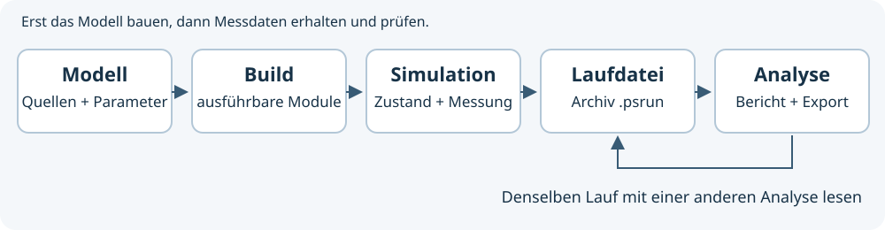

# Physim User Guide

Mit Physim kannst du eine physikalische Frage in ein Modell übersetzen, einen
Lauf aufzeichnen und seine Messwerte auswerten. Dieser Guide führt durch die App.
Du kannst zunächst eine Vorlage benutzen, ohne ein eigenes Programm zu schreiben.
Zum Schreiben eigener Modelle führen danach die Lernwege für
[C](c-guide.md) und die [Physim Sprache](physim-guide.md).

## Dein erster abgeschlossener Versuch

Dein Ziel ist ein gespeicherter Pendellauf mit einer auswertbaren Kurve.
Physim muss bereits installiert und geöffnet sein; die
[Installationsbefehle](../README.md) erklären den Quellbuild für dein System.

1. Öffne **Datei → Neues Projekt**, wähle den Typ **Experiment** und die Vorlage **Pendel**.
2. Wähle einen freien Projektordner sowie Experiment- und Auswertungssprache.
   Drücke **Projekt anlegen**. Vorhandene Quellen werden dabei nicht ersetzt.
3. Drücke **F5** oder **Build**. Warte, bis Build und Parameterabfrage erfolgreich sind.
4. Wechsle zu **Simulieren**. Starte mit **F6** und beobachte einige Schwingungen.
5. Drücke **Stoppen** oder **F9**. Öffne **Auswerten** und starte die Analyse.
6. Öffne ein Ergebnisdiagramm. Exportiere bei Bedarf CSV für Zahlen, SVG für
   eine skalierbare Grafik oder PNG für ein Bild.

Prüfe dein Ergebnis: Du siehst eine periodische Bewegung, eine Laufdatei im
Projektordner `runs` und einen Bericht. Die Szene zeigt den Modellzustand;
die Kurve zeigt aufgezeichnete Werte. Beim Stoppen bleibt der Lauf erhalten.
Ein schöner Screenshot allein ersetzt diese Prüfung nicht.

**Eigene Erklärung:** Was bleibt erhalten, wenn du das Projekt schließt?
Was kommt aus dem Experiment und was entsteht erst durch die Analyse?

## Das Arbeitsmodell verstehen

Der Ablauf besteht aus fünf getrennten Schritten:

| Schritt | Ergebnis | Wo du ihn findest |
| --- | --- | --- |
| Quellen und Parameter wählen | Beschreibung deines Modells | Entwickeln und Parameterformular |
| Bauen | Ausführbares Experiment und Analysemodul | Build und Protokoll |
| Simulieren | Modellzustände und Messwerte | Simulieren |
| Lauf stoppen | Gespeicherte Messdaten und Herkunft | runs und Laufbibliothek |
| Analysieren | Tabellen, Diagramme und Exporte | Auswerten |

Eine geänderte Quelle braucht einen neuen Build. Ein gespeicherter Lauf behält
seine damals aufgezeichneten Werte. Du kannst ihn später mit einer anderen
Analyse untersuchen, ohne die Simulation zu wiederholen.
[Archiv und Laufbibliothek](runs.md), [unabhängige Analyse](saved-run-tutorial.md).

## Eine kontrollierte Änderung ausprobieren

Ändere immer zunächst eine Größe, damit du eine Wirkung zuordnen kannst.
Die Pendelvorlage besitzt zum Beispiel `length`, `initialAngle`, `mass` und
Parameter des Mediums. Im Formular stehen Einheit, Standardwert und Grenzen.
Die Einheiten und gespeicherten Werte gehören zum Modell, nicht nur zur Anzeige.
[Alle Pendelparameter und Grenzen](workspace.md).

Vergleiche die Pendellänge:

1. Zeichne einen Lauf mit der Standardlänge auf.
2. Sage voraus, ob ein längeres Pendel schneller oder langsamer schwingt.
3. Vergrößere nur `length`, starte einen weiteren Lauf und stoppe ihn.
4. Wähle beide Läufe in **Läufe und Berichte** aus und vergleiche ihre Kurven.

Für kleine Winkel lautet die Näherung `T = 2π√(L/g)`. Vierfache Länge bedeutet
in diesem Modell ungefähr doppelte Schwingungsdauer. Bei großen Winkeln reicht
diese Näherung nicht aus. Der [Pendellernpfad](pendulum-tutorial.md) erklärt die
nichtlineare Referenz und den Einfluss des Integrators.

**Vertiefung:** Warum verändert eine andere Masse die Kleinwinkelperiode des
idealen Pendels nicht? Gilt dieselbe Aussage auch für jede Art von Widerstand?

## Szene und Kamera benutzen

Mit der rechten Maustaste drehst du die freie 3D-Kamera, mit der mittleren
verschiebst du sie und mit dem Mausrad zoomst du. **2D-Modus** richtet die Kamera
an einer Ebene aus. **Vorne**, **Seite** und **Oben** wählen XY, YZ und XZ.
Perspektive und orthografische Ansicht sind getrennte Entscheidungen.

Unter **Szeneneinträge** blendest du einzelne Objekte aus. Unter **Darstellung**
steuerst du Vektoren, Flugbahnen, Punkte und Beschriftungen gemeinsam.
Ausgeblendete Geometrie beeinflusst Messwerte nicht und wird bei der Auswahl
in der Szene ausgelassen. **Alle einblenden** stellt einzelne Einträge wieder her;
ein deaktivierter gemeinsamer Darstellungsschalter bleibt weiterhin maßgeblich.

**Als Projektvorgabe speichern** merkt sich Modus, Ebene, Projektion und die
Darstellungsschalter. **Standard** stellt die freie Standardkamera her.
[Details und Tastenkürzel](workspace.md). Die [räumliche Erklärung](spatial-explanations.md)
verbindet Kamera, Winkel, Position und Kraftpfeile mit eigenen Beobachtungen.

## Zeit und numerische Genauigkeit unterscheiden

Die Simulationsgeschwindigkeit ändert, wie schnell du den Versuch beobachtest.
Der Zeitschritt entscheidet dagegen, in welchen Zeitabständen das Modell
numerisch fortgeschrieben wird. Ein schneller dargestellter Versuch ist daher
nicht automatisch weniger genau.

Vergleiche für eine Genauigkeitsprüfung dasselbe Modell mit kleinerem
Zeitschritt. Prüfe eine Zielgröße, beispielsweise die Schwingungsdauer oder die
Energiebilanz. Nutze im Vakuum die mechanische Energie, bei Widerstand zusätzlich
die dissipierte Energie. Ein physikalischer Verlust ist kein numerischer Fehler.
[Integratorvergleich und Energiebilanz](pendulum-tutorial.md),
[adaptive Schritte](workspace.md#adaptive-simulationsschritte).

**Eigene Prüfung:** Halbiere den festen Zeitschritt. Welche Kennzahl nähert sich
an? Welche Modellannahme bleibt unabhängig vom Zeitschritt unverändert?

## Messung und Modell auseinanderhalten

Das Modell liefert den berechneten Zustand. Ein Sensor kann zusätzlich Rauschen,
Ausfälle und Standardunsicherheit besitzen. Ein fehlender Messwert ist kein
Messwert null. Gemeinsam auszuwertende Kanäle müssen zeitlich zueinander passen.
[Sensoren und Messstatus](measurement.md), [Datenreihen](series.md).

Vergleiche beim [Wurf mit Unsicherheit](monte-carlo-tutorial.md) erst den
Einzellauf, dann eine Gruppe von Seeds. Eine Streuung der Endwerte und die
Unsicherheit des geschätzten Mittelwerts beantworten unterschiedliche Fragen.

## Ergebnisse teilen

CSV eignet sich zum Weiterrechnen, SVG für skalierbare Abbildungen und PNG für
Bildausgaben. Lies die Bedeutung des gewählten Exports: Ein Rohdatenexport
enthält die ursprünglichen Messpunkte; ein Ergebnisdiagramm kann eine für die
Darstellung reduzierte Reihe enthalten. Einheiten, Modellannahmen, Seed und
numerische Einstellungen gehören zu einem nachvollziehbaren Vergleich.
[Berichte und Export](reports.md), [Archivformat](data-format.md).

## Wenn ein Schritt nicht funktioniert

- **Der Build scheitert:** Lies die erste konkrete Diagnose und ihre Quellposition.
  Prüfe auch die installierten Compilerwerkzeuge. [Build](build.md), [Diagnosen](diagnostics.md).
- **Der Lauf startet nicht:** Prüfe Werte und Grenzen im Parameterformular und
  ob die aktuellen Quellen erfolgreich gebaut wurden.
- **Die Auswertung fehlt:** Stoppe den Lauf, wähle passende Eingaben und baue
  gegebenenfalls die Analyse. Ein Analyseprojekt braucht einen gespeicherten Lauf.
- **Die Ansicht wirkt leer:** Prüfe Kameraebene, Zoom sowie einzelne und globale
  Sichtbarkeit, bevor du das Modell änderst.

[Fehlerbehebung](troubleshooting.md) erklärt weitere Fälle.
[F1 und Tastaturbedienung](workspace.md#fenster-hilfe-und-tastenkürzel) helfen beim Nachschlagen.

## Weiterlernen

Wähle ein [Example](examples.md) nach der physikalischen Frage.
Schreibe danach ein eigenes kleines Experiment in [C](experiment-tutorial.md)
oder [Physim](language-tutorial.md). Du brauchst die API-Referenz erst, wenn du
einen Vertrag genauer nachschlagen möchtest.

[Handbuch](guide.md) · [Examples](examples.md) · [SecondBrain](secondbrain.md)
