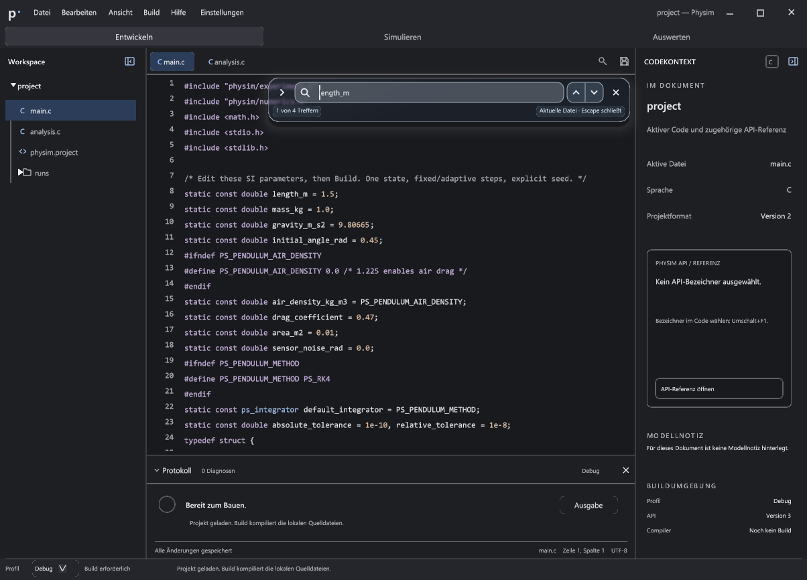
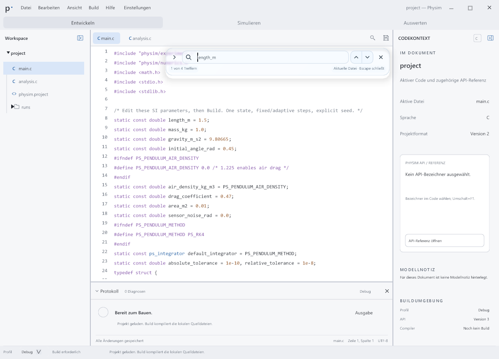

# Werkbank: enger Abgleich mit der gewählten Vorlage

Stand: 20. Oktober 2026, Ausgangsrevision `154c61b`, Zweig `codex/f1-design-h`.
Die Rückmeldung „das design ist nicht ansatzweise umgesetzt“ bezieht sich auf
Entwickeln / Werkbank. Die bisherigen Funktionsprüfungen waren keine visuelle
Abnahme. Diese Überarbeitung gleicht die native Oberfläche mit
`glass-cool-dark.png`, `glass-cool-light.png`, `workbench.css`, `glass.css` und
den Vektorpfaden aus `workbench.js` ab. Die alten Bilder bleiben als Gegenbeleg
erhalten. F1 / Design H ist ein gesonderter Arbeitsbereich.

## Sichtbare Korrekturen

- Eigene Werkbankfarben für feste Leseflächen, Auswahl, Rahmen und Syntax;
  die allgemeine Palette anderer Ansichten bleibt erhalten.
- Schriftrollen entsprechend den CSS-Größen. Nuklear interpretiert seine
  Schrifthöhe anders als CSS: Die tatsächliche em-/Aufstieg-/Abstieg-Metrik
  der geladenen Schrift wird vor der Atlasbereinigung ermittelt. Das behebt
  die zuvor deutlich zu kleinen Bedienlabels. Code ist bei neuen Einstellungen
  12 px groß; vorhandene Schriftpräferenzen werden erhalten. F1 behält seine
  bisherige Mindestgröße 16 für Beispielcode.
- Durchgehender 72-px-Kopf, kompakte Hauptnavigation und 28-px-Dateitabs mit
  5-px-Rundung, Sprachmarkern sowie echten Schließen-/Dirty-Zuständen.
- Linker Schalter im Workspace-Kopf, beim Schließen vor den Tabs; rechter
  Schalter an einer festen Position. Die Original-Vektorpfade ersetzen die
  bisherigen generischen Fenstericons. Tastaturfokus folgt dem wieder sichtbaren
  Schalter; neue Tastatur-/Mauseingaben haben Vorrang vor verzögertem Fokus.
- Dateibaum mit 31-px-Zeilen, Pfadlinien, aktiver Datei und der gewünschten
  Reihenfolge tatsächlich vorhandener Quellen, Projektdatei und Verzeichnisse.
  Windows-Pfadtrennzeichen verhindern die Auswahlmarkierung nicht mehr.
- Rechter Kontext mit abgestuften Überschriften, Sprachbadge und gerahmter
  API-Karte. Die Buildumgebung bleibt bei Standardschrift vollständig sichtbar.
  Überschriften werden mit Buchstabenabstand gezeichnet und für Accessibility
  weiterhin als zusammenhängende Wörter ausgegeben.
- Protokollkopf, Ergebnisbereich, eigene 26-px-Editorstatuszeile und 32-px-Fußzeile
  folgen der Vorlage. Der Protokollknopf wächst mit der gewählten Schrift.
  Die Suche verwendet passende Schriftrollen und das vorhandene native Glas.

## Prüfungen und Aussagegrenzen

Die exakten Binär-, Quellen-, Referenz- und Bildfingerprints sowie konkrete
Ergebnisdateien stehen in [native-fidelity-validation.json](native-fidelity-validation.json).
Alle 36 Bilder in [native-refined](native-refined/) sind ausschließlich verlustfrei
aus den tatsächlich aufgenommenen BMPs konvertiert; keine Retusche oder
Komposition. Die Matrix umfasst je Plattform dunkel/hell und vier Seitenzustände,
schmal, große Schrift, deckenden Materialfallback und hohen Kontrast.

Der unabhängige [Bildprüfer](../../../tests/check_workbench_visual.py) prüft zehn
begrenzte Eigenschaften der Standardansicht: Clientgröße, Menüschriftmaß,
drei Farbflächen sowie fünf Trennlinien. Dunkel und hell bestehen unter Windows
und Linux. Beide Referenzen bestehen die Selbstprobe; die alte Windows-Ansicht
scheitert weiterhin an mehreren Eigenschaften. Diese zehn Prüfungen sind **keine
10/10-Bewertung der gesamten Oberfläche**. Zusätzlich wurden die tatsächlichen
Bilder einschließlich großer Schrift manuell angesehen.

Die native Werkbankmatrix prüft Such-/Ersetzungsgeometrie, Cursor und Scrollstand,
vier Seitenzustände, Fokus-Rückgabe, Separator-Tastatur, Mausresize/Abbruch/Reset
und die Priorität von Modaldialogen. Windows prüft tatsächlichen Fensterfokus.
Die Ergebnisse und die zeitliche Abgrenzung der breiteren Regressionen sind im
Manifest festgehalten. Windows verwendet MSVC/ASan und NVIDIA OpenGL; Linux
wurde tatsächlich in Alpine-Dev mit GCC, ASan/UBSan, Xvfb/Openbox und Mesa ausgeführt.

- Aktuelle Windows-Werkbank: **6/6 App-Läufe bestanden**.
- Aktuelles Linux: **2/2 Abläufe bestanden**, Werkbankmatrix und Compilerdiagnosen.
- Unmittelbar vor der letzten Korrektur der Protokollknopfbreite: Linux
  **4/4** für Werkbank, Dateitabs, Ersetzen und API-Referenz.
- Breitere Linux-Regression vor den letzten visuellen Verfeinerungen: **13/13**
  einschließlich Einstellungen, Themes, Build, Completion und F1; getrennt
  davon Windows-Modellprüfungen **13/13**. Das sind keine erneuten Vollprüfungen
  exakt des letzten Zeichenstands.
- Die übliche Windows-EXE samt passendem PDB ist aktualisiert; ihr tatsächlicher
  `--smoke`-Start bestand. SDL- und ASan-Laufzeit-DLLs stimmen mit dem geprüften
  separaten Build überein.

Nach dem Sichern der aktuellen Nachweise wurden 126 ersetzte erfolgreiche
Werkbank-Rohbilder entfernt, zusammen 543.096.876 Byte (rund 518 MiB).
[Bereinigungsprotokoll](native-refined/cleanup.json). Aktuelle Rohbilder,
Fehlernachweise, alte eingefrorene Referenzen und F1-/Orca-Arbeiten bleiben erhalten.

macOS wurde für diese Änderung nicht gebaut. Physischer Monitorwechsel und
Windows-Systemskalierungen sind hier nicht nachgewiesen. Eine vollständige
Screenreader-Abnahme ist weiterhin offen. Die im gemeinsamen Arbeitsstand
vorhandenen separaten F1-/AT-SPI-Änderungen sind im Manifest kenntlich gemacht;
sie gehören nicht zum Designcommit.

## Verbleibende Unterschiede und ihre Gründe

| Unterschied zur Browservorlage | Grund / Grenze |
| --- | --- |
| Reale Dateinamen, API-Daten und Buildzustände statt der Pendel-Demotexte | Die Vorlage enthält simulierte Inhalte. Die App zeigt das tatsächlich geöffnete Projekt; fehlende Ordner werden nicht erfunden. |
| Metadaten statt der vorgetäuschten Dokumentgliederung | Eine echte Symbolgliederung benötigt einen geeigneten Parser/Index. Die derzeitige Implementierung zeigt vorhandene Datei-, Sprach- und Formatdaten; eine vollständige Gliederung bleibt offen. |
| API-Karte mit Handbuch/Schließen bzw. verständlichem Leerzustand | Es gibt keine allgemein implementierte Aktion „Beispiel einfügen“. Diese Wirkung wird nicht durch einen funktionslosen Demoknopf vorgetäuscht. |
| Modellnotiz ohne automatische Pendelformel | Für das aktive Dokument existiert derzeit kein Modellnotiz-Datenvertrag. Daher wird keine fremde Formel als zum Code gehörig dargestellt. Eine bearbeitbare Modellnotiz mit mathematischem Satz ist noch offen. |
| Echte Dateischließaktion und etwas breitere Tabs | Die App erhält Schließen, Reorder, Overflow und ungespeicherte Dateien; die Vorschau zeigt nur vereinfachte Tabs. |
| Native Windows-Fensteraktionen mit größeren Trefferflächen | Die Browserglyphen sind dekorativ. Minimieren, Maximieren und Schließen bleiben echte, getrennte Aktionen. |
| Bereits gespeicherte Schrift- und Dockgrößen | Ein Designupdate setzt persönliche Einstellungen nicht zurück. Die Vergleichsfixture verwendet ausdrücklich 218/255/154 px; die bestehenden nativen Standardgrößen bleiben erhalten. |
| Abweichende Schriftglättung sowie kleine Restabstände | Windows-Schriften und Linux-Noto werden durch den nativen Atlas statt Browser-ClearType/CSS gerastert; identische Pixel sind damit nicht belegt. Die Hauptgeometrie und Schriftmaßstäbe sind separat geprüft. |

Diese Unterschiede sind nicht pauschal „nativ unmöglich“. Insbesondere echte
Symbolgliederung und Modellnotizen erfordern weitere Daten-/Funktionsarbeit.
Sie werden nicht als bereits umgesetzt bewertet.
