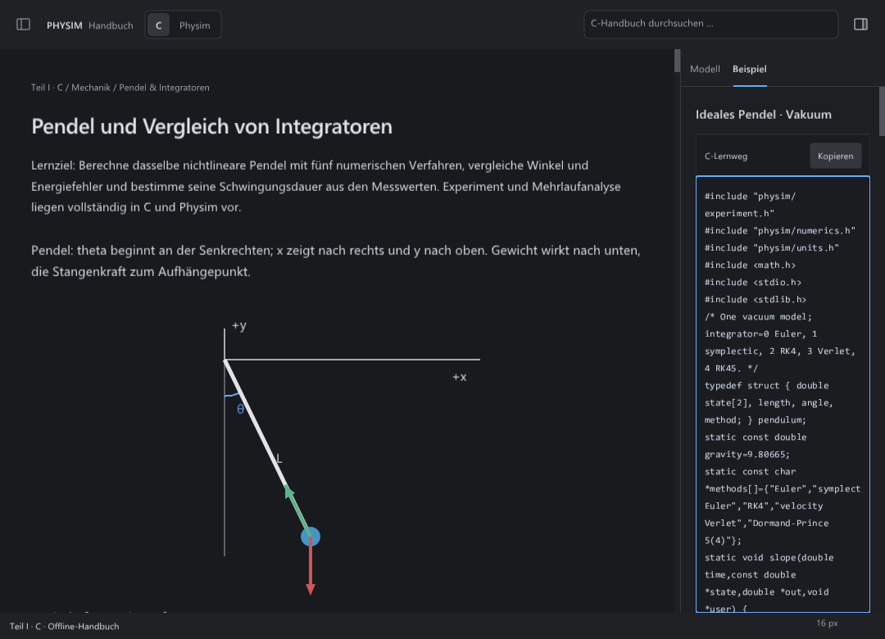
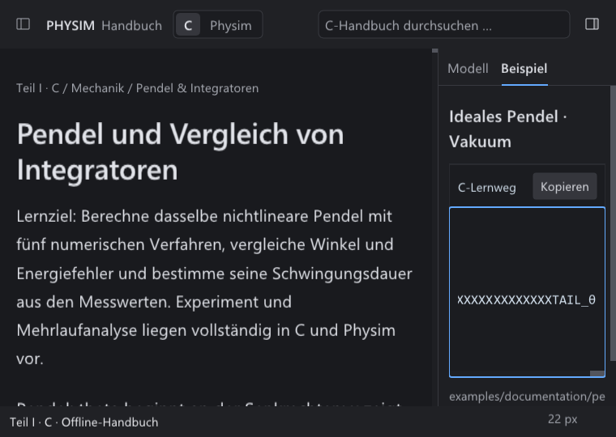
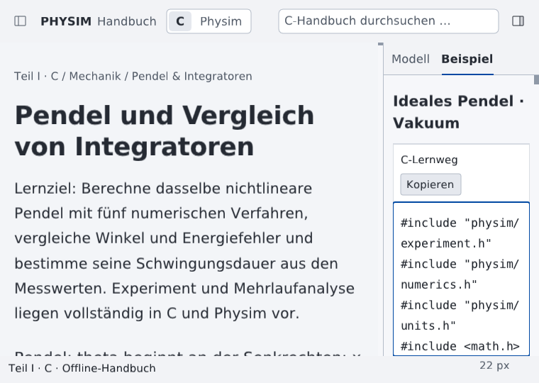

# F1 H: Codevorschau mit erhaltenen Tokens und horizontalem Zugriff

Fortgeschrieben durch den [Kontextdetail-Abgleich](CONTEXT-DETAILS.md): Der dort
geprüfte Folgestand beseitigt den unten noch offenen Codekopf-Konturrest und
korrigiert die SVG-Bildunterschrift. Die folgenden Nachweise beschreiben Stand 91.

Der Folgeabgleich vom 21. Oktober 2026 setzt den Vertrag aus
`final-h.css` für `.context-content pre` um: `white-space: pre-wrap`,
`overflow-wrap: normal`, `overflow-x: auto`. Er ergänzt den
[SVG-Schriftabgleich](SVG-LABELS.md); die vollständigen realen C-/Physim-
Beispielquellen bleiben erhalten.

## Umbruch und Darstellung

Die bisherige Vorschau brach auch lange Bezeichner mitten im Token um und
ließ beim Umbruch einzelne Leerzeichen weg. Außerdem wurde jede gezeichnete
Zeile in einen 4096-Byte-Puffer kopiert. Das neue Layout erhält die Original-
Bytebereiche, Einrückung, Tabs, Leerzeilen und harte Zeilenumbrüche. Ein
untrennbares Token kann breiter als der Sichtbereich sein und bleibt über
die horizontale Position vollständig erreichbar. Leerraum am Zeilenende
wird für den notwendigen Überlauf nicht künstlich verbreitert.

Die Umbruchmöglichkeiten stammen aus der unveränderten Zeilenumbruch-Teilmenge
von [libunibreak 8.0](https://github.com/adah1972/libunibreak/releases/tag/libunibreak_8_0),
fest auf `28a2756b864c343f438cd22537d49d394d4666a5`. Physim ergänzt dazu
Glyphenmessung und `pre-wrap`-Verhalten, einschließlich 8-Space-Tabstopps,
unsichtbarem bedingtem Trennzeichen und ZWSP. Gezeichnet werden nur sichtbare
Zeilen und Glyphen; horizontales Verschieben baut den Text nicht neu um.
Die bestehende Codeschrift folgt weiterhin der eingestellten Editorgröße.

Die [CSS-Spezifikation](https://www.w3.org/TR/css-text-3/#white-space-property)
unterscheidet erhaltenen Leerraum von unzulässiger Fragmentierung eines
Tokens. Die Anwendung verwendet die deutsche, normale Sprachvariante der
Bibliothek. Der vollständige Unicode-Konformitätstest verwendet dagegen
wie der [Upstream-Prüfer](https://github.com/adah1972/libunibreak/blob/28a2756b864c343f438cd22537d49d394d4666a5/src/tests.c)
den Modus `-strict`; insbesondere die CJ-Behandlung ist damit ausdrücklich
konfiguriert. Diese Bibliotheksprüfung beweist keine vollständige Browser-
oder Schriftformungs-Engine.

## Bedienung

Der Codebereich erhält bei horizontalem Überlauf einen eigenen Tabstopp
nach „Kopieren“. Die vorhandenen F6-Paneelziele bleiben unverändert.

| Eingabe | Wirkung |
| --- | --- |
| Links / Rechts | Horizontale Position um vier gemessene Leerzeichen verschieben. |
| Home / End | Linkes beziehungsweise rechtes Ende erreichen. |
| Hoch / Runter, Bild hoch / runter | Die äußere Kontextspalte vertikal bewegen. |
| Horizontales Mausrad / Umschalt+Mausrad über dem Code | Horizontale Position ändern, ohne die Kontextspalte vertikal zu bewegen. |
| Scrollleistengriff ziehen / freie Spur anklicken | Position direkt beziehungsweise seitenweise ändern. |
| Umschalt+Tab | Zum Kopierknopf zurückkehren; bei Bedarf wird dieser vertikal sichtbar gemacht. |

Die horizontale Leiste verwendet das bestehende Nuklear-Material und einen
mindestens 18 px breiten Griff, damit auch sehr lange Tokens noch per Maus
erreichbar bleiben. Es gibt keine zusätzlichen sichtbaren Navigationsbuttons.
Die Leiste gehört zum Ende des Codeblocks; sie wird nicht als neuer schwebender
oder klebender Balken eingeblendet. Die Sprache hat ihre eigene horizontale
Position; bei einer anderen geladenen Kontextquelle werden beide Positionen
zurückgesetzt.

Der vorhandene native Range-Adapter veröffentlicht die Position mit Name,
Minimum, Maximum und Schrittweite. Die Plattformbrücke stellt diesen Adapter
als numerischen Schieberegler bereit. Ein eigenes UIA/AX/AT-SPI-ScrollPattern
für den Codebereich und vollständiges externes Screenreader-Lesen des gesamten
Codes sind damit nicht nachgewiesen. Der sichtbare Ausschnitt und die bestehende
vollständige Kopieraktion bleiben zugänglich. Allgemeine Schriftformung,
Bidi-Verhalten und nicht im bestehenden Fontvorrat enthaltene Zeichen sind
separate offene Grenzen.

## Daten, Besitz und Offline-Betrieb

Das Layout leiht den unveränderten Quellpuffer und speichert Bytebereiche und
gemessene Zeilen. Eine neu berechnete Variante ersetzt den Cache erst nach
erfolgreichem Aufbau. Bei Quellwechsel und Schließen wird das Layout vor seinem
geliehenen Puffer freigegeben; Font-/Dichte-/Breitenwechsel erzwingen neue Maße.
Eine fehlgeschlagene Vorschau ersetzt weder Quelle noch Clipboard-Inhalt.

Die neuen Quellen, Unicode-Tabellen, Lizenzen und der vollständige komprimierte
Unicode-Testdatensatz liegen [offline im Repository](../../../third_party/libunibreak-8.0/README.md).
Dateihashes und Upstream-Git-Blob-IDs stehen im Manifest. Das SDK übernimmt
die Bibliothekslizenz und die Unicode-Datennotiz; zur Laufzeit wird nichts
heruntergeladen. Die bestehende Serifenschrift aus dem vorigen Teilstand und
alle Formelsatz-Assets bleiben unverändert.

## Tatsächlich ausgeführte Prüfungen

Geprüft ist der eingefrorene Quellstand **91**, auf Basis `41fc632`, mit
82 LF-normalisierten Quelldateihashes, 14 Font- und 20 Umbruch-Assethashes.
Die zehn gesondert erfassten fremden Änderungen bleiben unverändert.
Die anschließende Katalogkorrektur und Git-Byteerhaltung sind als zwei
zusätzliche, nicht in die App kompilierte Dateien separat erfasst.

| Plattform / Prüfung | Ausführung | Ergebnis |
| --- | --- | --- |
| Windows, MSVC / ASan | `run-68xwcng6` | **3/3**: H, Paneelnavigation, Codevorschau. |
| Alpine-Dev, ASan / UBSan | `run-jn517awv` | **2/2**: Paneelnavigation, Codevorschau. |
| Alpine-Dev, vollständiges H mit gleicher Binärdatei und Arbeitsdaten auf ext4 | `f1-91-h-ext4` | **1/1**, 39,865 s; unverändertes internes Limit 60 s. Kein vollständiger neuer H-Lauf mit Arbeitsdaten auf `/mnt/d`. |
| Windows, unabhängiger Win32-Fokusbeobachter | `run-2cncslm7` | **1/1**: alle 24 nativen Paneelzustände; tatsächlicher Vordergrund-, aktiver Fenster- und Tastaturfokus beobachtet. |
| Windows, reine C-Prüfungen | `run-8c8quues` | **2/2**: Vorschauvertrag und vollständiger Unicode-Umbruchdatensatz. |
| Alpine-Dev, reine C-Prüfungen | `run-fhyu4wzi` | **2/2**, dieselben beiden Prüfungen. |
| Windows / Alpine-Dev, Testkatalog und Fehlerbehandlung | `f1-code-catalog-*-91-03.log` | Auf beiden Plattformen bestanden. |
| Windows, Release-Paketprobe | `F1-code-sdk91` | Erzeugung erfolgreich; alle **3.314** Manifestdateien und beide neuen Lizenzkopien bytegenau geprüft. Keine vollständige neue SDK-Funktionsabnahme. |

Die sieben Eingabefälle je Plattform verteilen C/Physim auf Hell, Dunkel und
hohen Kontrast, 1080-/760-px-Fenster sowie UI-/Editorgröße 16/22. Sie prüfen
Home/End, horizontales Rad, Umschalt+Rad ohne vertikale Bewegung, tatsächliches
Ziehen des Griffs, Umschalt+Tab zurück zu Kopieren und die vollständige Kopie.
Editorinhalte und Simulationszeit bleiben erhalten. Der siebte Fall verwendet
eine isolierte 6.050-Byte-Quelle mit 6.000 Zeichen langem Token, UTF-8 und Tabs;
keine echte Beispieldatei wird dafür verändert. Die realen Quellen umfassen
7.419 beziehungsweise 5.260 Bytes einschließlich ihrer CRLF-Zeilenenden.

Beide C-Konformitätsläufe prüfen **19.338 vollständige Unicode-17-Fälle,
ohne übersprungene Fälle**. Das prüft die Bibliothek im ausdrücklich genannten
Strict-Modus; der UI-Vertrag wird separat anhand realer Eingaben geprüft.
Die Fehlerprüfungen umfassen ungültiges UTF-8, eingebettetes NUL und ungültige
Messwerte; eine systematische Injektion aller möglichen Allokationsfehler
wurde nicht ausgeführt.

Der Vorher-/Nachher-Vergleich von Stand 86 und 91 umfasst **112 vollständige
native H-Bildpaare**, 56 je Plattform. Alle sind pixelidentisch. Die neue
Codeansicht wird in 21 eigenen Rohaufnahmen je Plattform geprüft; 16 davon
sind hier verlustfrei als PNG erhalten. Der H-Vergleich ist ein
Regressionsnachweis, kein Bildvergleich gegen die Browserreferenz.

### Gegenfälle und Korrekturen

Die negativen Vorläufe werden nicht als erfolgreiche Abnahme gezählt:

- Stand 87 kompiliert zunächst wegen des falschen Nuklear-Stilmitglieds
  `scrollbarh` nicht; der tatsächliche Member heißt `scrollh`.
- Stand 88 scheitert in der neuen Eingabeprüfung: künstliche Maus-/Radereignisse
  besaßen nicht die im vorhandenen Testfilter verlangte Gerätekennung.
- Stand 89 weist einen Produktionsfehler nach: Der allgemeine Mausfokuspfad
  überschreibt die logische Codefokusrückkehr nach dem Ziehen. Die Codeansicht
  behält jetzt ihren ausdrücklich gesetzten Tastaturpfad.
- Stand 90 verwendet im Prüfaufbau eine ungültige Editorgröße 32. Der echte
  Einstellungsvertrag erlaubt 12 bis 22; nur der separate Leserzoom reicht
  bis 32. Windows-ASan und Linux-UBSan melden den dadurch verursachten
  Arrayzugriff. Stand 91 verwendet die gültige Größe 22.
- Der erste reine Unicode-Lauf verwendet versehentlich den normalen statt
  des Upstream-Strict-Modus und scheitert an der CJ-Behandlung. Nach Korrektur
  des Prüfmodus besteht der gesamte Datensatz; die App bleibt im normalen
  deutschen Modus.
- Der erste zusätzliche Katalogaufruf lässt das vorgeschriebene `--work` weg.
  Der korrigierte Aufruf findet anschließend eine bereits im Ausgangsstand
  veraltete Allowlist für `backdrop_ui`. Diese enthält jetzt den tatsächlich
  vorhandenen Test; beide abschließenden Katalogläufe bestehen.

Die unveränderten Upstream-Dateien sind über `.gitattributes` vor einer
Windows-Zeilenendenkonvertierung geschützt. Die Paketprobe erfolgte vor
Abschluss dieses Berichts; ihr eingefrorenes Manifest beschreibt genau ihren
damaligen Paketinhalt.

## Belege und Speicherpflege

[Validierung](code-preview-2026-10-21/validation.json) enthält Quellstände,
unveränderte Fremdhashes, tatsächliche Befehle und Ergebnisse, negative Vorläufe,
Bild-/Paket-/Bibliothekshashes sowie den unabhängigen Windows-Fokusbericht.
[Abschlussprüfung](code-preview-2026-10-21/audit.json) hält den begrenzten
Quellen-, Dokumentations- und Belegabgleich fest.

Nach dem erfolgreichen Ersatz wurden **144** obsolete Rohbilder erfolgreicher
Paneeltests aus den Ständen 88 bis 90 entfernt: **236.410.272 Bytes**.
Alle fehlgeschlagenen Codeprüfgruppen, die H-Referenzaufnahmen von Stand 86,
die aktuellen Rohbelege und sämtliche Programme/Debug-Symbole bleiben erhalten.
Einzelpfade, Hashes und Größen stehen im
[Bereinigungsnachweis](code-preview-2026-10-21/cleanup.json).

## Verbleibende Abnahme

Dies ist ein Teil des [Gesamtauftrags](../unified-workspace/NATIVE-FIDELITY.md).
Vollständige H-/Gesamtoberflächen-Gleichheit, Browser-Rasterung, Bildunterschrift,
Linux-Schrift und neue tatsächliche macOS-/externe Assistive-Nachweise bleiben
offen. Die lokale interaktive HTML-Datei ist weiterhin kein neu ausgeführter
Browsernachweis. Vorhandene lokale Accessibility-Arbeiten werden getrennt
erhalten; lokale Builds belegen keinen sauberen Checkout nur dieses Patches.

Auch einzelne Kontur- und Fokuszustände des vorhandenen Beispielkopfs sind
noch abzugleichen: Seine vierseitige Kontur entspricht noch nicht ausdrücklich
dem CSS-Vertrag `border-bottom: 0`. Das ist ein offener Umsetzungsrest und
keine nachgewiesene technische Unmöglichkeit. Ein numerischer Range-Adapter
beweist zudem weder das Lesen des vollständigen Codes durch externe
Assistive-Technik noch ein natives ScrollPattern.
