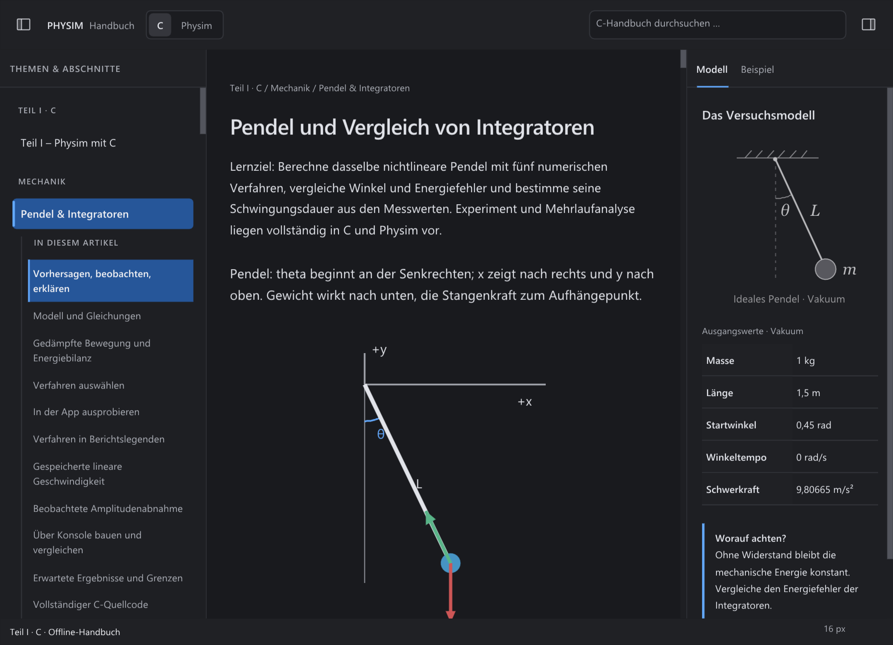

# F1 H: Codekopf und SVG-Bildunterschrift

Der Folgeabgleich vom 21. Oktober 2026 ergänzt die
[Codevorschau](CODE-PREVIEW.md) und den [SVG-Schriftabgleich](SVG-LABELS.md).
Er korrigiert zwei belegte Darstellungsreste in der bestehenden nativen Oberfläche.

## Codekopf

`layouts.css` verlangt für `.code-head` einen 1-px-Rahmen mit
`border-bottom: 0`. Der bisherige vierseitige, weich gerasterte Strich erzeugte
eine zusätzliche Kante vor dem ohnehin umrahmten `pre`-Feld. Der Kopf zeichnet
jetzt drei scharfe, ein Pixel breite Flächen. Die gemeinsame untere Kante gehört
dem Codefeld. Hintergrund und Kanten werden vor der Ausgabe auf den tatsächlichen
Scrollclip begrenzt. Kopierknopf, Umbruch, Abstände und Fokusfunktionen bleiben
erhalten; es gibt keine neue sichtbare Bedienfläche.

Sieben reale Codezustände je Plattform prüfen die Kopfgeometrie und die
tatsächlichen Pixel: drei Themes, C/Physim, UI-/Editorgröße 16/22 und der lange
UTF-8-Gegenfall. Eine eigene Kopfaufnahme hält den Fokus auf „Kopieren“, damit
der äußere Fokusrahmen des Codefelds die zu prüfende Kontur nicht überlagert.
Die vollständigen Tastatur-/Rad-/Zieh-/Kopierabläufe der Vorschau bestehen weiter.

## Bildunterschrift und Besitz

Die Vorlage `model.svg` enthält die Bildunterschrift bei `x=110`, `y=203`,
mit mittiger Verankerung und Schriftgröße 13 in einer 220 × 210 großen ViewBox.
Die einzeilige native Beschriftung folgt jetzt demselben Maßstab wie die Grafik.
So werden bei 213 × 205 logischen Pixeln aus 13 genau etwa **12,586 em-Pixel**;
bei 193 × 180 sind es etwa **11,143**. Mittelpunkt und Grundlinie folgen den
SVG-Koordinaten. Die
[SVG-Regeln für die ViewBox-Abbildung](https://www.w3.org/TR/SVG2/coords.html#ComputingAViewportsTransform)
beschreiben die entsprechende zentrierte, proportionale Abbildung.

Nuklear bewahrt den Fontzeiger bis zur späteren GL-Konvertierung auf. Deshalb
liegt auch der abgeleitete Beschriftungsfont dauerhaft im F1-Zustand. Beim
Ersetzen der Schriftbank und beim Schließen wird er zusammen mit dem bereits
vorhandenen Zeichenfont zurückgesetzt. Es entsteht keine weitere Atlas- oder
GL-Ressourcenverwaltung und keine neue Schriftabhängigkeit.

Die im [Designvertrag](DESIGN-H.md) zusätzlich verlangte Anpassung an große
UI-Schrift bleibt erhalten: Eine mehrzeilig benötigte Bildunterschrift behält
die gewählte größere Schrift und ihren zugänglichen Umbruch. Das eingebettete
SVG der HTML-Vorlage wickelt seinen Text selbst nicht um. Diese native Anpassung
erfüllt den zusätzlichen Großschriftvertrag; sie ist keine technische
Unmöglichkeit einer festen SVG-Abbildung.

## Ausgeführte Prüfungen

Maßgeblich ist der eingefrorene Stand **94** auf Basis `bda25ee`: 89
Quelldateihashes, 14 Font- und 20 Umbruch-Assethashes. Die zehn gesondert
erfassten fremden Änderungen bleiben unverändert.

| Umgebung | Ausführung | Tatsächliches Ergebnis |
| --- | --- | --- |
| Windows, MSVC / ASan | `run-32x1_loq` | **6/6**: Schriftbedarf, Dichte, Paneele, vollständiges H, Codevorschau und Modellraster. |
| Alpine-Dev, ASan / UBSan | `f1-94-display-ext4` | **6/6**, gleiche Anwendungsbinärdatei über alle Gruppen; H in **38,641 s**, Paneele in **29,545 s**. Temporäre Arbeitsdaten auf ext4, Quellen und ausführbare Datei auf `/mnt/d`; interne Anwendungsfrist unverändert 60 s. |
| Windows / Alpine-Dev, Katalog und Fehlerbehandlung | `f1-context-catalog-*-94.log` | Beide Läufe bestanden. |
| Windows, Release | `f1-context-release-94.log` | Aktuelle Startversion erfolgreich gebaut: `build/native/Release/bin/physim.exe`. Keine neue vollständige SDK-Paketabnahme. |

Die neue Modellprüfung zeichnet je Plattform **zwölf** Zustände: sechs mit
Systemschriften und dieselben sechs mit erzwungenen Offline-Schriften. Je
Schriftquelle werden ein breites dunkles Fenster, ein schmales helles Fenster
und ein schmales Kontrastfenster mit UI 22 / Leser 32 bei Atlasdichte 1 und 2
gezeichnet. Der 2×-Export hat tatsächlich 2160 × 1560 beziehungsweise
1520 × 1080 Pixel. Das ist ein Nachweis für Atlas und GL-Rasterziel;
ein tatsächlicher Hardware-DPI-/Monitorwechsel wurde damit nicht ausgeführt.

Die Prüfung liest ViewBox, Verankerung und Schriftgröße unabhängig aus dem
festgelegten SVG. Sie untersucht die tatsächlich eingereihten Textbefehle,
vollständige Glyphen und deren Clip sowie die erzeugten Bildgrößen. Der
Umbruch der größeren UI-Schrift wird gesondert auf vollständige Darstellung
geprüft. Die vorhandene H-Matrix ergänzt 28 sichtbare Modellzustände je Plattform.

**112 vollständige H-Bildpaare** aus Stand 91 und 94 bleiben außerhalb der
jeweiligen Bildunterschrift pixelidentisch. 48 Bilder ändern dort Schriftpixel;
64 bleiben vollständig gleich. Vier weitere C-/Physim-Beispielpaare sind
außerhalb des Codekopfs pixelidentisch. Die bereitgestellten **24 PNGs** sind
verlustfreie native Aufnahmen; vorhandene native PNG-Ausgaben wurden unverändert
übernommen. Das ist ein begrenzter nativer Regressionsvergleich.

[Windows: C-Codekopf](context-details-2026-10-21/windows-code-c-dark.png) ·
[große Physim-Schrift](context-details-2026-10-21/windows-code-physim-large-dark.png) ·
[Offline-Modell bei 2×](context-details-2026-10-21/windows-bundled-model-dark-2x.png) ·
[Linux: schmales helles Modell bei 2×](context-details-2026-10-21/linux-model-narrow-light-2x.png) ·
[Linux: große Kontrastschrift](context-details-2026-10-21/linux-model-large-contrast-2x.png).

## Gegenfälle und Grenzen

Stand 92 verwendet bereits den neuen SVG-Prüfer, aber die alte Darstellung.
Beide Plattformen zeichnen alle sechs damaligen Zustände vollständig; die
unabhängige Prüfung lehnt anschließend die unskalierte Schriftgröße 13 statt
12,586 ab. Auch der alte vierseitige Codekopf aus Stand 91 scheitert an der
neuen tatsächlichen Pixelprüfung der gemeinsamen Kante.

Stand 93 besteht die neue Modellprüfung auf beiden Plattformen. Seine erste
Konturprüfung misst allerdings versehentlich den überlagernden Akzent-Fokusrahmen
am Codefeld. Die zusätzliche Kopfaufnahme in Stand 94 prüft nun den richtigen
Darstellungszustand mit unveränderten Pixelanforderungen. Zwischen 93 und 94
ändern sich nur der Testablauf und sein Python-Prüfer, keine Produktionsdarstellung.

Der Linux-Paneellauf aus Stand 93 erreicht mit Arbeitsdaten auf `/mnt/d` nur
23 von 24 Zuständen vor der 60-s-Frist. Dieser Lauf bleibt fehlgeschlagen.
Der vollständige neue Stand wird mit ext4-Arbeitsdaten und unveränderten
Fristen geprüft. Eine erfolgreiche neue vollständige Suite mit Arbeitsdaten
auf `/mnt/d` wird daraus nicht abgeleitet; die geänderte Speicherbedingung
ist im Nachweis ausdrücklich erfasst.

Schriftfamilien und Glyphenrasterung können wegen System-/Offline-Fonts und
dem vorhandenen nativen Rasterpfad weiter von den Browserbildern abweichen.
Eine weitergehende Angleichung ist nicht als generell technisch unmöglich
nachgewiesen. Es gibt keinen neuen interaktiven Browser-, macOS- oder
vollständigen externen Screenreader-Nachweis. Vollständige H-Gleichheit und
die gesamte Oberfläche einschließlich des verbindlichen Grafikexports bleiben
offen; siehe [Gesamtabnahme](../unified-workspace/NATIVE-FIDELITY.md).

## Belege und Speicherpflege

[Validierung](context-details-2026-10-21/validation.json) und
[Abschlussprüfung](context-details-2026-10-21/audit.json) erfassen Quellstände,
Befehle, Binärdateien, Vorläufe, Bildmasken und Hashes. Nach Abschluss wurden
46 ersetzte Rohbilder erfolgreicher 93er-Schrift-/Dichte- und Windows-Paneeltests
entfernt: **69.825.818 Bytes**. Alle fehlgeschlagenen Gruppen, die 92er-Gegenfälle,
91er-Vergleichsreferenzen und aktuellen 94er-Ausgaben bleiben erhalten.
Programme und Debug-Symbole bleiben erhalten.
[Einzelpfade, Größen und Hashes](context-details-2026-10-21/cleanup.json).
