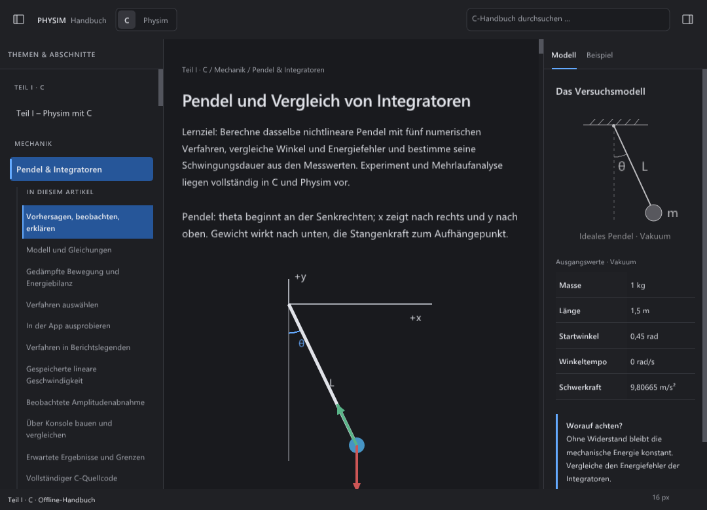

# F1 H: Navigation und Kontext nach den CSS-Maßen

Der Folgeabgleich vom 21. Oktober 2026 übernimmt die deklarierten Maße aus
`layouts.css`, `refinements.css` und `final-h.css`. Der vorherige
[Scrollabgleich](SCROLL.md) bleibt als historischer Stand erhalten.
Insbesondere seine 220/190 px breiten Themenflächen enthielten noch die
äußere 1-px-Panelkante. Mit korrektem CSS-`border-box` sind es jetzt
**219/189 px**; die Paneele selbst bleiben 250/220 px breit.

## Native Umsetzung

C/Physim und Modell/Beispiel messen die jeweils aktive beziehungsweise normale
Schriftstärke. Die Sprachsegmente erhalten die deklarierten 10 px Innenabstand
je Seite; die Kontextreiter keinen zusätzlichen Breitenzuschlag. Ihre ausgewählte
Unterstreichung bleibt nach der Trennlinie zwei volle Pixel hoch. Sie wird nicht
mehr von dieser Linie teilweise überdeckt.

Gruppenbeschriftungen verwenden 10 px, echte halbfette Schrift, 0,8 px
Zeichenabstand und 1,5-fache Zeilenboxen. Darunter liegen 13 px Abstand;
zwischen Themengruppen 21 px. Themenzeilen verwenden 13 px bei 1,45-facher
Zeilenhöhe, 9/10 px Innenabstand, 5 px Eckradius und den 3-px-Auswahlstreifen.
Die Paneelüberschrift hat eine eigene halbfette 11-px-Rolle mit 0,6 px Tracking.
Alle Rollen folgen der allgemeinen UI-Schriftgröße, unabhängig vom Leserzoom.

Abschnittslinks beginnen 19 px rechts von der Themenkante: 11 px Außenabstand,
1 px Gliederungslinie und 7 px Innenabstand. Ihre Schrift ist 12 px groß, die
Zeilenhöhe 1,55-fach und der obere/untere Innenabstand jeweils 7 px. Der Block
beginnt 9 px nach dem Thema und endet mit 15 px Abstand. Auch die Beschriftung
„In diesem Artikel“ darf vollständig auf mehrere Zeilen umbrechen. Reale
Überschriften werden weder gekürzt noch auf die kurzen Mockup-Texte reduziert.

Position und Größe werden nicht mehr getrennt abgeschnitten. Die beiden
gemessenen Kanten werden gemeinsam auf ganze native Pixel gerundet; Zeichnung,
Mausziel und nativer Fokus verwenden dasselbe Rechteck. Der ursprüngliche
78er-Gegenfall verlor durch getrenntes Abschneiden fast zwei Pixel.

Die Kontextspalte hat einen 46-px-Kopf und eine volle Scrollfläche hinter ihrer
1-px-Außenkante. Innen gelten oben 21 px, seitlich 18/13 px und unten 30 px.
Titel, Bild, Tabellenbeschriftung, Werte und Hinweis verwenden ihre jeweiligen
CSS-Zeilenboxen und Abstände. Die Tabelle erhält halbfette Feldnamen und die
vorgegebene Hintergrundfläche. Ihre Spaltenbreiten berücksichtigen die wirklich
vorhandenen Textbreiten; sie sind nicht mehr pauschal halbiert. Eine vollständige
Gleichheit mit dem automatischen Browser-Tabellenalgorithmus ist damit nicht bewiesen.

Die vier Pixel anonymer Grundlinienraum unter dem inline eingebetteten SVG
werden am 14-px-Kontexttext berücksichtigt. Dies ist aus dem Inline-Aufbau und
dem unveränderten PNG abgeleitet, keine neue Browsermessung: Die erste
Feldnamenfläche beginnt im Original bei y=451, nach Abzug der 35-px-Mock-
Fensterleiste bei y=416.

Die Pendelgrafik folgt dem vorhandenen `model.svg`, einschließlich dessen
Koordinaten, Strichbreiten und Farbtransformation `invert(.88)` im dunklen Theme.
Einzeilige SVG-Texte verwenden jetzt die tatsächliche Font-Grundlinie statt
eines geschätzten Schriftgrößen-Abzugs. Mehrzeilige Beschriftungen bleiben bei
großer UI-Schrift vollständig im Bild. Die kursiven Georgia-Glyphen der drei
Grafikzeichen sind noch nicht nativ hinterlegt; die UI-Schrift ist dort
weiterhin ein sichtbarer Unterschied.

Der Beispielreiter erhält den Sprachkopf, den sichtbaren Button „Kopieren“
mit erhaltenem nativen Namen „Code kopieren“ und die Codefläche. Bei großer
Schrift bricht der Kopf um, bevor Beschriftung und Kopierziel überlappen.
Ein aus dem Sichtbereich gescrollter Kopierknopf wird bei Tastaturfokus in
seiner eigenen Kontext-Scrollfläche sichtbar gemacht. Clipboard-Inhalt und
vollständige reale C-/Physim-Quelldateien bleiben erhalten. Lange Tokens werden
in der nativen Vorschau weiterhin umbrochen; die horizontale Browser-Scroll-
variante von `overflow-wrap: normal` ist noch nicht gleichwertig umgesetzt.

## Abgrenzung

Die Native-Dokumente enthalten mehr Abschnitte als die Browserdemo; das Modell
enthält zusätzlich die dokumentierte Schwerkraft. Deshalb sind Textumfang,
Tabellenzeilenzahl und daraus folgende Höhe nicht mit einem Austausch gegen
die verkürzte Demo gleichzusetzen. Die zusätzlichen Inhalte bleiben erhalten.

Dies ist keine vollständige H-/Gesamtoberflächenabnahme. Schriftsetzung,
Rasterung, SVG-Schrift und weitere Randdetails bleiben offen, unter Linux auch
die abweichende Schriftgrundlage. Es gibt keinen neuen interaktiven Browser-,
macOS- oder vollständigen externen Screenreader-Nachweis. Der lokale Browser-
zugriff auf die HTML-Datei blieb gesperrt. Unverändert vorgefundene lokale
Accessibility-Änderungen gehören nicht zu diesem Paket und werden separat
gehasht; die lokalen Builds sind kein sauberer Checkout nur dieses Commits.

Die übrige Oberfläche einschließlich des verbindlichen Grafikexports bleibt
im [Gesamtauftrag](../unified-workspace/NATIVE-FIDELITY.md) erhalten.

## Ausgeführte Prüfungen

Der eingefrorene Stand 83 basiert auf `b8a4740`. Der
[Nachweis](side-flow-2026-10-21/validation.json) enthält 71 normalisierte
Quellhashes, zehn getrennte Hashes vorgefundener Accessibility-Arbeiten,
Binärhashes, Originalausgaben, Referenzhashes und die ausgeführten Kommandos.
Windows verwendet MSVC/ASan, Linux GCC/ASan+UBSan. Die Prüfungen verwenden
dieselben funktionalen Erwartungen und
unveränderte Toleranzen wie die vorausgehenden Läufe.

| Plattform / Ausführung | Ergebnis | Einordnung |
| --- | --- | --- |
| Windows, `run-0_7jj3wh` | 16/16 Gruppen | Vollständiger ausgewählter F1-Lauf, einschließlich tatsächlicher Tastatur-/Mauseingaben. |
| Linux, `run-j9rfj7us` | 15/16 Gruppen | H beendet alle 56 Layoutzustände; späterer Abbruch an Stufe 37 nach 60,269 s. |
| Linux, `run-be_zm1pr` | H nicht bestanden | Unveränderte Wiederholung erreicht Stufe 48 und endet nach 60,149 s. |
| Linux, `f1-83-h-storage` | H bestanden, 44,320 s gesamte Prüfausführung | Gleiches Binary, gleicher vollständiger Python-/nativer H-Test, weiterhin 60 s internes Limit; nur das Arbeitsverzeichnis liegt unter Linux-`/tmp`. |

Damit sind auf jeder Plattform alle 16 verschiedenen Gruppen positiv belegt,
unter Linux über den breiten Lauf und die ausdrücklich getrennte Speicherort-
Gegenprobe. Es gibt keinen durchgehend grünen finalen Linux-Lauf auf `/mnt/d`.
Die einzelne sequentielle Gegenprobe spricht für einen Speicherorteinfluss;
sie isoliert dessen Anteil gegenüber sonstiger Laufzeitstreuung nicht und
belegt keine Beschleunigung des Programms. Die fehlgeschlagenen Läufe bleiben
erhalten. Der vorherige Stand 82 bestand auf beiden Plattformen je 16/16;
er enthält noch die breiteren Kontextreiter und ist kein Ersatz für Stand 83.

Die neue Matrix erfasst 28 Navigations- und 28 Kontextzustände je Plattform,
einschließlich großem Lesertext, 22-px-UI, Hell/Dunkel/hohem Kontrast und
unabhängig geschlossenen Seitenflächen. Sechs Beispielköpfe prüfen den
Umbruch ohne Überdeckung des Kopierknopfs. Der H-Ablauf prüft dessen
tatsächliche Fokusfreilegung und den vollständigen Clipboard-Inhalt.

112 Artikel-Ausschnitte aus Stand 77 und 83 sind pixelidentisch. Diese
Vergleiche umfassen ausschließlich den bisherigen mittleren Artikelbereich;
die absichtlich geänderten Seitenflächen und der Kopf sind ausgeschlossen.
Dies ist keine Gleichheit vollständiger H-Fenster. Alle 16 bereitgestellten
PNGs wurden verlustfrei aus den jeweiligen nativen BMPs übernommen.

Der begrenzte Referenzvergleich bestätigt unter Windows die zwei vollen
Unterstreichungszeilen des Modellreiters bei x=13…50 relativ zur Panelkante,
in Hell und Dunkel. Unter Linux beträgt die Breite mit der dortigen Schrift
45 statt 38 px; das bleibt ein negativer Referenzbefund. Themenfläche und
rechte Kante stimmen auf beiden Plattformen in y=240…276 und bis x=233
überein. Der strenge Vergleich aller drei reinen Akzentpixel bleibt rot:
Die dritte Pixelspalte der Browserreferenz ist bereits geglättet, während
der native Streifen dort die volle Akzentfarbe zeichnet. Diese Abweichung
wird weder durch einen geänderten Grenzwert noch durch eine volle H-Freigabe verdeckt.

Die bestehenden begrenzten Flächenprüfungen bestehen auf beiden Plattformen
in Hell und Dunkel. Die Titelkantenprüfung besteht unter Windows und bleibt
mit der anderen Linux-Schrift negativ. Fehlgeschlagene Vorläufe 78–82 sind
mit Ursachen im Nachweis enthalten: getrennte Kantenrundung, ein falsch
zugeordneter Theme-Index im Prüfer und zwei unzutreffende Annahmen über
einzeilige Beschriftungen bei großer UI-Schrift.

## Native Aufnahmen

Windows, normale Schrift:

[Helles Theme](side-flow-2026-10-21/windows-h-light.png) ·
[32-px-Leseschrift](side-flow-2026-10-21/windows-reader-32.png) ·
[22-px-UI dunkel](side-flow-2026-10-21/windows-ui-22-dark.png) ·
[22-px-UI hell](side-flow-2026-10-21/windows-ui-22-light.png) ·
[C-Beispiel](side-flow-2026-10-21/windows-example-c.png) ·
[Physim-Beispiel](side-flow-2026-10-21/windows-example-physim.png) ·
[Beispielkopf mit 22-px-UI](side-flow-2026-10-21/windows-example-ui-22.png).

Linux, H-Bilder aus der erfolgreichen Speicherort-Gegenprobe; der große
Beispielkopf stammt aus der erfolgreichen Paneelgruppe des breiten Laufs:

[Dunkles Theme](side-flow-2026-10-21/linux-h-dark.png) ·
[Helles Theme](side-flow-2026-10-21/linux-h-light.png) ·
[32-px-Leseschrift](side-flow-2026-10-21/linux-reader-32.png) ·
[22-px-UI dunkel](side-flow-2026-10-21/linux-ui-22-dark.png) ·
[22-px-UI hell](side-flow-2026-10-21/linux-ui-22-light.png) ·
[C-Beispiel](side-flow-2026-10-21/linux-example-c.png) ·
[Physim-Beispiel](side-flow-2026-10-21/linux-example-physim.png) ·
[Beispielkopf mit 22-px-UI](side-flow-2026-10-21/linux-example-ui-22.png).

## Review und Bereinigung

Das Quellreview umfasst die Lebenszeit der 32 geliehenen Schriftrollen,
unverändert zwei Paarabstandsressourcen, ausgeglichene Style-/Gruppenstapel,
die wiederhergestellte Clipkante, identische Zeichen-/Maus-/Fokusrechtecke und
die Fokusfreilegung in der jeweils eigenen Scrollfläche. Der vorgefundene
Accessibility-Diff bleibt unberührt und wird nicht mit eingecheckt.
Der [Abschlussaudit](side-flow-2026-10-21/audit.json) prüft die zugehörigen
Hashes, Bilder, JSON-/Python-Syntax, lokalen Dokumentlinks und `git diff --check`.
Diese Selbstprüfung ersetzt weder die offenen Plattformnachweise noch eine
vollständige visuelle Abnahme.

Die [abgeschlossene Bereinigung](side-flow-2026-10-21/cleanup.json) entfernt
870 ersetzte BMPs aus erfolgreichen 78–82er-Läufen: **1.863.192.060 Byte**
(etwa 1,74 GiB). Jede Datei wurde vorher mit Größe und SHA256 geprüft; gelöscht
wurden ausschließlich einzeln aufgelistete Dateien in eigenen Testverzeichnissen.
H-/Scroll-/Formelbilder, alle Fehlerfälle, aktuelle 83er-/Gegenprobenbilder,
Referenzen, Quellen, Abhängigkeiten und die WSL-Distribution bleiben erhalten.
