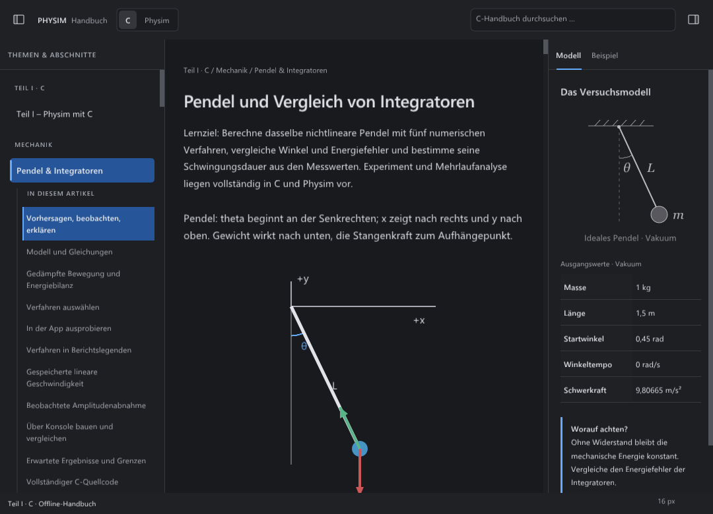

# F1 H: echte kursive Serifenschrift im Modell

Der Folgeabgleich vom 21. Oktober 2026 ergänzt den
[Navigations-/Kontextabgleich](NAV-CONTEXT.md). Das verbindliche `model.svg`
verwendet für θ, L und m `Georgia,serif`, 20 SVG-Einheiten und kursiven Stil.
Die bisherigen nativen Zeichen verwendeten dagegen die normale UI-Schrift.

## Umsetzung und Besitz

Eine eigene Schriftrolle lädt Georgia Italic aus dem vorhandenen Windows-
Schriftverzeichnis. Unter Linux werden installierte Georgia-/DejaVu-Serif-
Italic-Dateien geprüft; unter macOS sind die Georgia-Pfade vorgesehen.
Wenn keine passende Systemdatei vorhanden ist, steht Noto Serif Italic offline
bereit. `PHYSIM_TEST_BUNDLED_FONTS=1` erzwingt auch für diese Rolle den
mitgelieferten Font. Es gibt keinen Fontdownload beim Bauen oder zur Laufzeit.

Die Rolle gehört zur bestehenden transaktionalen F1-Schriftbank. Benötigte
UI-Größen werden ergänzt; ein Dichtewechsel ersetzt die Bank. Ein fehlgeschlagener
Aufbau darf die alten Handles, Einstellungen und Lesestelle nicht verändern.
Die vier möglichen UI-Größen sind zusätzliche Rollen neben den unverändert
42 allgemeinen F1-Textvarianten. Die tatsächliche Gesamtzahl im anfänglich
benötigten Zustand wächst von sechs auf sieben; nach den unabhängigen
Größenwechseln der Bedarfskontrolle von 15 auf 17.

Der Font enthält den ASCII-Grundzeichensatz und θ. Das erhält die bestehende
Atlasprüfung jedes druckbaren ASCII-Zeichens. Der 84er-Gegenfall mit nur vier
Glyphen scheiterte beim Atlas-Upload, bevor F1 geöffnet werden konnte; die
Produktprüfung wurde unverändert beibehalten. Stand 85 ergänzt den erforderlichen
Grundzeichensatz. Diese Grafikrolle ersetzt keinen allgemeinen Text-/Fallbackfont.
Der zweite Gegenfall 85 verwendete einen lokalen Font für die skalierten
Zeichen. Nuklear behält den Fontzeiger bis zur späteren GL-Konvertierung;
der Sanitizer fand deshalb einen Zugriff nach Ende der lokalen Lebensdauer.
Stand 86 hält diesen abgeleiteten Font im dauerhaften F1-Zustand. Die neue
Rolle und der abgeleitete Zeichenfont werden beim Bankersatz/Schließen zurückgesetzt.

Die Glyphen werden mit ihrem tatsächlichen CSS-em gebacken und anschließend
mit demselben SVG-Maßstab wie Stange, Masse und Koordinaten gezeichnet. Ihre
Grundlinie stammt aus den realen Fontmetriken. Die bestehende Anpassung an
große UI-Schrift bleibt erhalten. Bei Dichtewechsel und Schließen gelten die
vorhandenen Atlas-Besitz- und Freigabepfade; es gibt keine zweite GL-Ressourcenverwaltung.

## Herkunft und Grenzen

Der unveränderte Noto-Font stammt aus der
[festgelegten offiziellen Distribution](https://github.com/notofonts/noto-fonts/blob/ffebf8c1ee449e544955a7e813c54f9b73848eac/hinted/ttf/NotoSerif/NotoSerif-Italic.ttf).
Die zugehörige [OFL-1.1-Datei](https://github.com/notofonts/noto-fonts/blob/ffebf8c1ee449e544955a7e813c54f9b73848eac/LICENSE)
und die vollständige Herkunft liegen unter `third_party/fonts`; das Manifest
fixiert Revision, Dateigröße und SHA256. Font und Lizenz werden mit dem vorhandenen
Fontverzeichnis in SDKs/Pakete übernommen. Georgia bleibt ein Systemfont.

Die Noto-Datei hat im `head`-Feld `macStyle=0`, obwohl Fontnamen „Italic“ und
`post.italicAngle=-12` den kursiven Schnitt ausweisen. Die Prüfung erfasst diese
Originalmetadaten statt die unveränderte Datei umzuschreiben oder einen
gesetzten `macStyle`-Italic-Bitwert zu behaupten. Georgia auf dem geprüften
Windows-Host hat `macStyle=2` und `italicAngle=-13`.

Dies belegt keine identischen Glyphen auf Systemen mit unterschiedlichen
Schriften. Unter Linux bleibt eine andere Serifenschrift ein sichtbarer
Unterschied zur Windows-Referenz. Unter Windows bleibt die Rasterung gegenüber
dem Browser separat zu beurteilen. macOS ist ohne neuen tatsächlichen Lauf
weiterhin offen. Die adaptive mehrzeilige Bildunterschrift, weitere Randdetails
und die horizontale Codevorschau sind nicht mit dieser Schriftkorrektur abgenommen.
Die übrige Oberfläche und der freigegebene Grafikexport bleiben Teil des
[Gesamtauftrags](../unified-workspace/NATIVE-FIDELITY.md).

## Tatsächlich ausgeführte Prüfungen

Der eingefrorene Stand 86 basiert auf `66ecbfe`. Der
[Nachweis](figure-font-2026-10-21/validation.json) enthält 74 normalisierte
Quellhashes, 14 Font-/Lizenzhashes, zehn separat erhaltene fremde
Accessibility-Dateien, die Systemfont-Metadaten, Binärhashes und die
vollständigen relevanten Ausgaben. Windows verwendet MSVC/ASan, Linux
GCC/ASan+UBSan. Keine Fehlerausgabe wurde durch einen späteren Lauf ersetzt.

| Ausführung | Ergebnis |
| --- | --- |
| Windows 86, `run-imi2_xit` | 6/6: Fontbank, mathematischer Zeichenvorrat, Schriftbedarf, Dichten, Details und H. |
| Linux 86, `run-mvtlllec` | 5/5 derselben Gruppen ohne H. |
| Linux 86, `f1-86-h-ext4` | Vollständiger H-Test bestanden, 40,549 s gesamte Prüfausführung, weiterhin 60 s internes Limit. Arbeitsdateien liegen unter Linux-`/tmp`. |
| Windows 86, `run-2vow9_ar` | 2/2 zusätzliche Schriftquellen-/Schriftschnittprüfungen. |
| Linux 86, `run-3r0pbjcy` | Dieselben 2/2 zusätzlichen Prüfungen. |
| Windows/Linux 84 | 1/6 beziehungsweise 1/5; begrenzter Glyphensatz verletzt den bestehenden ASCII-Uploadvertrag. |
| Windows/Linux 85 | 3/6 beziehungsweise 3/5; dauerhafte Bank gültig, lokaler Zeichenfont verursacht Sanitizerfehler beim Modellzeichnen. |

Auf jeder Plattform sind damit acht verschiedene, für diesen Patch ausgewählte
Prüfgruppen positiv belegt. Das sind keine aktuellen 16/16 des breiteren
[vorherigen Teilstands](NAV-CONTEXT.md). Der Linux-H-Test verwendet denselben
Prüfer und dieselbe interne Frist wie zuvor; sein einzelner Zeitwert ist
kein Geschwindigkeitsbenchmark und kein neuer Nachweis für `/mnt/d` als Arbeitsort.

Die H-Matrix zeichnet 28 sichtbare Modellzustände pro Plattform, einschließlich
großer UI-/Leseschrift sowie Hell/Dunkel/hohem Kontrast. Sie prüft reale
Quellglyphen für alle drei Zeichen und die unveränderte em-Größe. Die
Zeichenvorratsprüfung kontrolliert zusätzlich alle drei Modellzeichen in
allen vier Serifengrößen, auch bei erzwungener Offline-Schrift. Die
Bedarfskontrolle prüft erfolglose Fonttransaktionen, wiederverwendete Handles
und den Austausch bei Dichtewechsel. Die bestehende Dichteprüfung läuft bei
1,25/1,5/2/1; sie ist kein neuer separater Nachweis der Modellgrafik bei 2×.

112 native Vorher-/Nachher-Paare aus Stand 83 und 86 sind außerhalb der jeweiligen
Modellgrafik pixelidentisch. Die 112 mittleren Artikel-Ausschnitte sind ebenfalls
identisch. Je Plattform verändern sich 28 Bilder mit sichtbarer Modellgrafik;
die übrigen 28 sind vollständig unverändert. Das ist ein nativer
Regressionsnachweis und kein vollständiger Browser-Bildvergleich.
Die 16 bereitgestellten PNGs sind verlustfreie Übernahmen der nativen BMPs.

Der aktuelle Windows-H-Lauf lädt tatsächlich `georgiai.ttf`, der Linux-Lauf
`DejaVuSerif-Italic.ttf`. Im erzwungenen Offline-Lauf werden alle vier
Serifengrößen aus der im Manifest fixierten Noto-Datei geladen. Die nativen
Windows-Aufnahmen zeigen jetzt die kursiven Serifenformen der Vorlage;
identische Rasterpixel werden daraus nicht abgeleitet.

## Native Aufnahmen

[Windows hell](figure-font-2026-10-21/windows-h-light.png) ·
[Leseschrift 32](figure-font-2026-10-21/windows-reader-32.png) ·
[UI 22 dunkel](figure-font-2026-10-21/windows-ui-22-dark.png) ·
[UI 22 hell](figure-font-2026-10-21/windows-ui-22-light.png) ·
[Hoher Kontrast](figure-font-2026-10-21/windows-high-contrast.png) ·
[Noto offline 16](figure-font-2026-10-21/windows-bundled-16.png) ·
[Noto offline 32](figure-font-2026-10-21/windows-bundled-32.png).

[Linux dunkel](figure-font-2026-10-21/linux-h-dark.png) ·
[Linux hell](figure-font-2026-10-21/linux-h-light.png) ·
[Leseschrift 32](figure-font-2026-10-21/linux-reader-32.png) ·
[UI 22 dunkel](figure-font-2026-10-21/linux-ui-22-dark.png) ·
[UI 22 hell](figure-font-2026-10-21/linux-ui-22-light.png) ·
[Hoher Kontrast](figure-font-2026-10-21/linux-high-contrast.png) ·
[Noto offline 16](figure-font-2026-10-21/linux-bundled-16.png) ·
[Noto offline 32](figure-font-2026-10-21/linux-bundled-32.png).

## Review und Bereinigung

Das Review verfolgt die Font-/Zeichensatz-Lebenszeiten, den dauerhaft gespeicherten
Zeichenfont, die unveränderte ASCII-Uploadkontrolle, Fehlerpfade vor Bankübernahme,
den vollständigen Offline-Pfad und die Aufnahme der Assets in das vorhandene
Paketverzeichnis. [Abschlussaudit](figure-font-2026-10-21/audit.json) und
[Dateibereinigung](figure-font-2026-10-21/cleanup.json) halten die geprüften Hashes,
Syntax-/Linkprüfung und die entfernten, ersetzten Rohbilder fest.
34 Bilder ausschließlich erfolgreicher 84er-/85er-Fontbank-, Bedarfs- und
Dichtegruppen wurden nach Hashvergleich entfernt: 32.883.362 Byte.
Alle Fehlergruppen, 83er-Vergleichsreferenzen und aktuellen 86er-Bilder bleiben erhalten.
