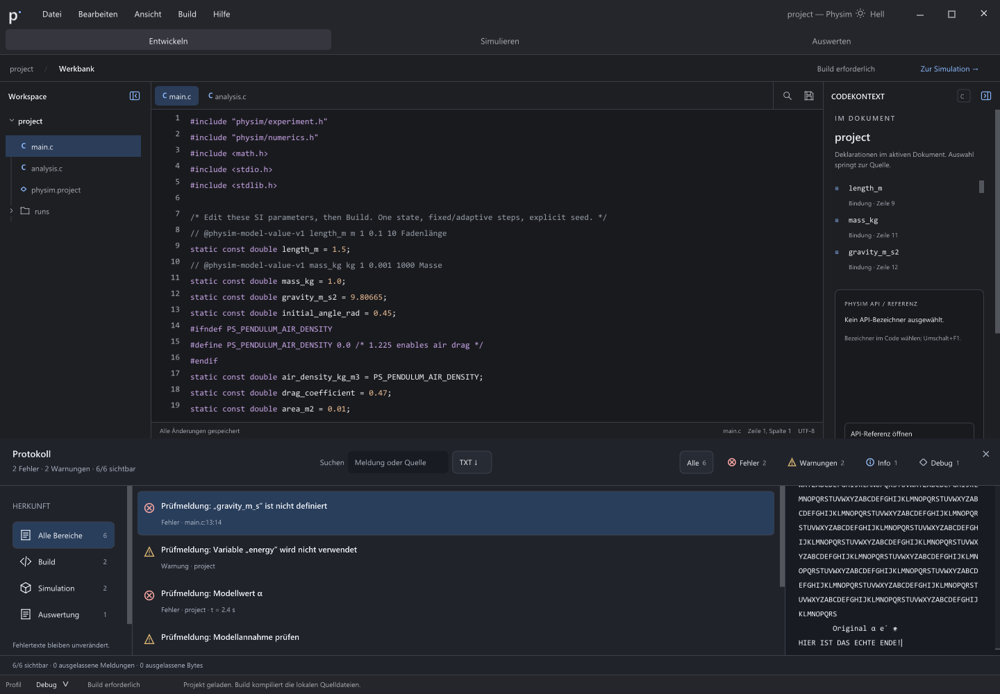

# Protokoll C: durchgehende Originalmeldung

Die künstlichen 12-KiB-Textseiten sind entfernt. Der native Detailbereich zeigt
die vollständige Originalmeldung mit weichem Umbruch, gemeinsamer Auswahl und
Kopie. Die ausgewählte [Vorlage C](../design-options/APPROVED.md) verwendet dafür
ebenfalls einen durchgehenden Textblock. Weitere Detailtypografie und
Blockabstände sowie die gesamte Oberfläche bleiben gesondert abzugleichen.

## Ursache und Umsetzung

Die alte Seitengrenze kam vom fest eingebetteten Accessibility-Textpuffer.
Sie war keine unvermeidbare Betriebssystemgrenze. [ADR 012](../../decisions/012-complete-readonly-text.md)
beschreibt den separat referenzgezählten Textspeicher: Kleine Werte bleiben im
bisherigen Puffer, große schreibgeschützte Inhalte werden einmal pro Generation
angelegt und zwischen Entwurf, Veröffentlichung und nativen Vergleichszuständen
geteilt. Speicherfehler ersetzen den veröffentlichten Text nicht teilweise.

Windows, AT-SPI und der macOS-Adapter lesen solche Texte unter dem Modellmutex
in eigene Ausgaben. Windows hält auch für Änderungsereignisse eine eigene Kopie;
AT-SPI hält seine vorherige Generation referenziert. Größere Auswahlen verwenden
beim nativen Kopieren keinen festen 12-KiB-Stackpuffer mehr. Die gemeinsame
Zeichen-/Bytezuordnung verwendet vorhandene Glyphenpositionen oder einen
linearen Durchlauf statt wiederholter Längenbestimmung pro Zeichen.

## Tatsächliche Nachweise

Die [aktuelle kompakte Ergebnisliste](../../verification/protocol-continuous-original-2026-10-27.json)
nennt die exakten Quellstände, Programme, Befehle, Ergebnisdateien und Hashes.
Die lokale Quellkopie enthält die eigenen Änderungen ohne die parallel
vorhandenen AT-SPI-Collection-Änderungen. Alte und neue Laufzeiten sind separat
archiviert und vollständig nachgelesen. Alle Ausgaben liegen auf D:.

| Kriterium | Beobachteter Nachweis |
| --- | --- |
| Fehler vor der Korrektur | Der alte native Stand zeigt bei 65.536 Originalbytes nur 12.288 Bytes; die unveränderte Volltext-/Kopiererwartung scheitert. Auch der neue 81.927-Byte-Modelltest erkennt die alte Puffergrenze. |
| Vollständige Darstellung | Je fünf native Fälle für Dunkel, Hell, Kontrast, größere Schrift und schmale Ansicht: vollständiger Text, sichtbares letztes Zeichen, Auswahl/Kopie einschließlich Unicode, CRLF und Tabulatoren, Erhalt beim Größenwechsel und abgewiesenes Löschen. |
| Unabhängiger Windows-Client | UIA liest alle 64 KiB sowohl als Wert als auch als TextPattern-Dokument und vollständige Auswahl. Ersetzen wird abgewiesen. Inaktives Scrollen zum Ende erhält Text, Auswahl, Caret und Fokus. Anschließend prüft die Anwendung den exakten Clipboard-Inhalt. |
| Unabhängiger Linux-Client | AT-SPI liest den vollständigen Text und die Unicode-Auswahl, weist Ersetzen ab und macht das zuvor unsichtbare letzte Zeichen ohne Fokus-/Auswahlverlust sichtbar. `EditableText.CopyText` liefert die gesamten 64 KiB an die echte SDL-Zwischenablage. |
| Speicher und Veröffentlichung | Wiederverwendung unveränderten Texts ohne neue Allokation, unveränderlicher veröffentlichter Inhalt, alte Referenz nach Entfernen/Zerstören, veraltete Auswahl-/Scrollaufträge, Allokationsfehler und 16-MiB-Einzel-/Gesamtgrenze geprüft. Alle vom Test erfassten Snapshot-Allokationen werden freigegeben. |
| Regressionen | Betroffene Modell-, Umbruch- und Textflussgruppen sowie F1-Editfelder geprüft. Zusätzliche native Protokoll-/Editorgruppen und die vollständige Testläufer-Regression sind im JSON ihrem jeweiligen Quell-/Programmstand zugeordnet. |

Prüfzweck dieses einen versionierten Bilds: Das echte Ende liegt ohne
Abschnittswechsel im selben nativen Detailbereich. Theme-/Größenfälle und
Bedienfolgen werden über die verknüpften Messwerte dokumentiert.

Windows: MSVC Release, native SDL-/OpenGL-Oberfläche. Linux: `Alpine-Dev`, GCC,
Debug mit ASan/UBSan, geerbte WSLg-Anzeige; die Protokollläufe melden Mesa 26.1.6 /
llvmpipe. Die Modelltests laufen mit `detect_leaks=1`, die GUI-Prüfungen mit
`detect_leaks=0`. Letztere sind deshalb kein Lecknachweis. Die gemessene zusätzliche
Snapshot-Spitze des Modelltests beträgt 16.859.177 Byte; das Modell selbst
belegt 8.549.640 Byte. Das ist keine Messung des gesamten Prozessspeichers.

Im anschließenden Review wurde eine Übergabe eines Teiltexts aus dem eigenen
Snapshot ergänzt. Die Gegenprobe scheitert unter Windows gezielt und unter
Linux mit ASan-`heap-use-after-free`. Die erste Teilkorrektur kopiert vor dem
Freigeben, lässt aber die spätere Grenzprüfung noch auf den alten Quellzeiger
zugreifen; ASan erkennt auch dies. Die abschließende Korrektur prüft die Grenzen
am neuen eigenen Wert und unterstützt überlappende Inline-Teilstücke mit
`memmove`. Der [frühere Teilnachweis](../../verification/protocol-continuous-original-2026-10-26.json)
bleibt seinem damaligen Stand zugeordnet und wird nicht nachträglich umgeschrieben.

## Sichtbarer Windows-Desktop

Nach dem vom Nutzer erbetenen Neustart konnte Computer Use das Testfenster
wieder sichtbar erfassen. Echte Mausklicks setzen zuerst den Suchfokus und
übertragen ihn anschließend auf die Höhenleiste. Die Mausziehung vergrößert
das Protokoll von 340 auf 380 Pixel. Der separate native UIA-Client bestätigt
übereinstimmend Fokus-Property und `GetFocusedElement` der Höhenleiste.

Die Computer-Use-Accessibility-Anzeige nennt dabei weiter den alten Suchfokus;
sie wird nicht als positiver Fokusbeleg verwendet. Der angeforderte Tastendruck
`Shift_L+Up` kommt im SDL-Ereignisprotokoll als Keycode `0x40000060`, Scancode 96
an: Nummernblock-8. Der echte Pfeil nach oben wäre `0x40000052`, Scancode 82.
Dieser Versuch belegt daher keinen erfolgreichen Windows-Pfeiltastenschritt.
Das Testfenster beendet sich später am festen 900-Sekunden-Limit mit Exitcode 1;
das ist kein bestandener vollständiger manueller Lauf und kein belegter Absturz.
Der direkte Pfeiltastennachweis bleibt offen.
Der Nutzer hat diese manuelle Prüfung ausdrücklich auf später verschoben und
meldet sich bei verfügbarer Zeit. Dafür bis dahin kein neues Testfenster starten
und keine erneute Mitwirkung anfordern. Die übrige Umsetzung läuft weiter.

## Grenzen und nächster Abgleich

64 KiB sind der ausgeführte native Volltextfall; die Modellgrenze von 16 MiB
ist zusätzlich geprüft. Maximale Layoutleistung und gesamter Speicherbedarf
für 16 MiB sind damit nicht belegt. Größere Schrift wurde wie in den bestehenden
Fällen mit 22 statt 16 px geprüft, also nicht mit 200 Prozent.

Der macOS-Adapter ist angepasst, aber hier nicht auf macOS gebaut oder nativ
abgenommen. Seine bisherigen einzeiligen AX-Zeilenmethoden sind kein Nachweis
vollständiger Mehrzeilen-Navigation. Tatsächliches Screenreader-Lesen,
zusätzliche DPI-/Monitorzustände und die vollständige C-/H-/Gesamtgestaltung
bleiben offen. Als Nächstes Detailtypografie und Blockabstände direkt gegen
die freigegebene C-Vorlage angleichen; die übrigen ausgewählten Oberflächen
behalten ihren vollständigen Auftrag.

Aufbewahrung: Zustandsfolgen und unabhängige Clients verwenden JSON/Text.
Eine ausgewählte native Endansicht veranschaulicht das tatsächliche Textende;
die übrigen Rohbilder der fünf Designzustände und Gegenproben bleiben im lokalen
Prüfbestand. Die nativen Reader-Läufe benötigen keine zusätzlichen Bilder.
Laufzeitarchive enthalten nur gegenüber dem vorherigen Index geänderte Dateien.
