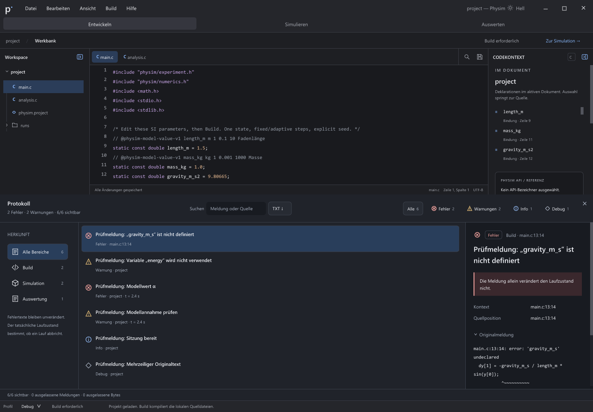
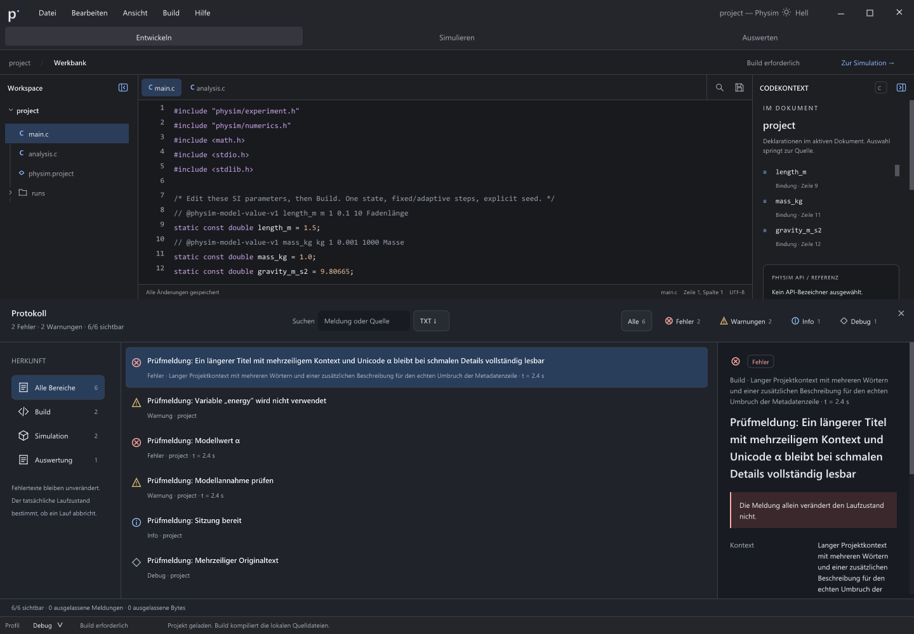

# Protokoll C: Detailtypografie und Blockabstände

Stand: 27. Oktober 2026. Die native Detailspalte übernimmt die Schriftrollen,
Zeilenhöhen und Abstände aus der [ausgewählten C-Vorlage](../design-options/APPROVED.md).
Der [kompakte Prüfnachweis](../../verification/protocol-detail-type-2026-10-27.json)
ordnet Messwerte, Befehle, Programme und Gegenproben ihren Quellständen zu.
Dies ist ein weiterer Teilabgleich; die vollständige C-/H-/Oberflächenabnahme
bleibt offen.

## Übernommene Maße

Die Werte beziehen sich auf die 14-px-Wurzel der Referenz bei normaler
nativer UI-Schriftgröße 16. Größere UI-Schrift skaliert diese logischen Maße.

| Element | Referenz und native Umsetzung |
| --- | --- |
| Metadaten neben dem Fehler-Badge | 10,92 px, Zeilenhöhe 16,926 px; tatsächliche Herkunft und Quellstelle beziehungsweise Kontext/Modellzeit |
| Badge | 9,8-px-Schrift; 19,92 px Gesamthöhe einschließlich Padding und Rand |
| Detailtitel | 17,5 px, Zeilenhöhe 27,125 px, 10 px oberer Abstand |
| Auswirkung | 11,2 px, Zeilenhöhe 17,36 px; 11/13 px Padding, 2-px-Akzentkante, 17 px Abstand oben/unten |
| Eigenschaften | Zwei gleich breite Spalten mit 14 px Zwischenraum, 10 px Abstand zwischen Zeilen; Zeilenhöhe 17,36 px |
| Originalmeldung auf-/zuklappen | 18 px oberer Abstand, 27,36 px Zeilenhöhe einschließlich 5 px Padding oben/unten |

Lange Metadaten wechseln wie im Flex-Umbruch der Vorlage in eine eigene Zeile.
Der bereits geprüfte durchgehende Originaltext und die inhaltsbreiten Aktionen
bleiben erhalten. Tatsächlicher Prozessausgang bestimmt den Auswirkungstext;
ein Fehler-Level allein stoppt keinen Lauf.

Die globale native Zeilenhilfe setzt bei großer Schrift eine Mindesthöhe von
26 px. Das verzerrte kleinere Textzeilen und Abstände. Diese Detailzeilen
verwenden deshalb die bereits vorhandene Hilfe für exakt bemessene Zeilen.
Die allgemeinen Mindesthöhen anderer Bedienelemente bleiben erhalten.

## Ausgeführte Prüfungen

Windows (MSVC Release) und Linux (Alpine-Dev, GCC Debug mit ASan/UBSan) bestehen
je sechs neue native Zustände: Dunkel, Hell, hoher Kontrast, UI-Schrift 22 statt
16, schmale Ansicht sowie langer Titel/Kontext. Der Python-Prüfer liest die
Sollwerte unabhängig aus der ausgewählten CSS-Datei und vergleicht sie mit
den tatsächlich angelegten Rechtecken und Schriftrollen. Der Quelltext bleibt
unverändert. Fünf absichtlich verfälschte positive Messsätze werden abgewiesen.

Windows besteht zusätzlich alle vier Protokollgruppen: Navigator, Aktionen,
Originaltext und unabhängiger UIA-Volltextclient. Linux besteht Aktionen,
Originaltext und den unabhängigen AT-SPI-Volltextclient. Im parallelen
Windows-/Linux-Nachlauf verlor das Linux-Fenster beim Suchfokus den tatsächlichen
Hostfokus; dieser negative Lauf bleibt dokumentiert. Der anschließend ohne
paralleles Windows-Testfenster ausgeführte Navigator besteht alle acht Fälle
mit unveränderten Prüfbedingungen und identischem Programmhash. Dies ist kein
Ersatz für den verschobenen manuellen Windows-Pfeiltastennachweis.

Der frühere Geometriegegenbeleg erkennt unter anderem 9,8 statt 10,92 px bei
Metadaten, falsche Zeilenhöhen und fehlende Eigenschaftsabstände. Die erste
Testvorbereitung verwendete zusätzlich eine unzulässige gespeicherte
Protokollhöhe von 680; sie wurde auf den erlaubten Wert 500 korrigiert. Deren
negativer Exitcode wird nicht allein dem Design zugeschrieben. Ein weiterer
Zwischenstand erfasst die zu großen Zeilen bei Schrift 22 und ein veraltetes
Rechteck des vollständig ausgeclippten Testkopfs. Der Test verwendet nun die
aktuelle Pane-Position für das Freiscrollen.

Linux läuft auf der geerbten WSLg-Anzeige mit `detect_leaks=0`; dies ist kein
GUI-Lecknachweis, kein physischer Mehrmonitortest und keine Wayland-Abnahme.
Die Programme und Symbole sind als Differenzarchive mit vollständigem
Hash-Rücklesen erhalten. Der isolierte Quellstand enthält die sieben eigenen
Änderungsdateien und keine fremden lokalen AT-SPI-/Orca-/Workflow-Änderungen.

Diese zwei versionierten Bilder belegen unterschiedliche visuelle Eigenschaften.
Die übrigen Zustände sind über JSON-Messwerte und lokale Rohbelege nachvollziehbar.
Zusammen benötigen die beiden Bilder 366.346 Byte. Alle Ausgaben liegen auf D:.

## Plattformkatalog und verbleibende Unterschiede

Die tatsächlichen macOS-CI-Läufe des vorigen Commits scheiterten bereits am
Katalogprüfer: Er erwartete 15 Designproben auch unter Darwin, obwohl deren
bestehende Einträge ausdrücklich Windows/Linux vorgeben. Der Prüfer bestätigt
jetzt diese deklarierte Zuordnung und prüft seinen vollständigen Vertrag unter
allen drei Plattformkennungen. Die Testläufer-Regression besteht lokal auf
Windows und Linux. Das simulierte Plattformkennzeichen belegt keine native
macOS-Ausführung; die 15 Designproben bleiben dort unbewiesen. Neue echte
CI-Ergebnisse sind separat ihrem Commit zuzuordnen.

Die Browserdemo enthält einen zusätzlichen erläuternden Absatz und
Uhrzeitangaben, für die das aktuelle Meldungsmodell keine eigenen Felder hat.
Sie werden nicht als erfundene Meldungsinhalte oder Zeitstempel eingefügt.
Die native Darstellung verwendet die tatsächlich übermittelten Originaltexte,
Quellstellen, Kontexte und Modellzeiten. Gleichartige echte Zusatzdaten
benötigen gegebenenfalls eine ausdrückliche Erweiterung des Datenvertrags.

Schriftrasterung, native Scrollbarbreite und Browserlayout können weiterhin
Pixelabweichungen verursachen. Dieser Nachweis prüft die genannten logischen
Maße; er behauptet keine vollständige Pixelgleichheit. Weitere C-Zustände,
die anderen ausgewählten Bereiche, F1 H, tatsächliche Screenreader-Nutzung
sowie zusätzliche DPI-/Monitor- und macOS-Nachweise bleiben Teil des Auftrags.
Die manuelle Windows-Prüfung bleibt bis zur Rückmeldung des Nutzers verschoben.
